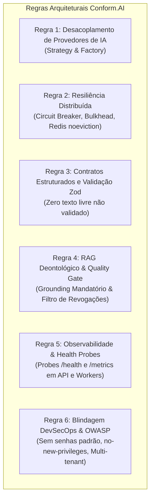

# 🏛️ Regras Arquiteturais Corporativas: Conform.AI Health

> **Status:** Mandatório e Inegociável  
> **Escopo:** Todo o ecossistema Conform.AI Health (Backend, Frontend, Workers, RAG, Pipelines e Infraestrutura)  
> **Governança:** Time de Arquitetura (@architect), Segurança (@security-reviewer), IA (@ai-engineer), Backend (@backend-specialist) e QA (@qa-engineer).

---

## 📌 Visão Geral & Princípios Fundamentais

O Conform.AI Health opera no setor de regulação, deontologia médica e conformidade em saúde (CFM, LGPD, ANVISA, ANS). Dada a sensibilidade jurídica, ética e operacional das auditorias médicas, a arquitetura é regida por 6 regras inegociáveis de engenharia de software e DevSecOps.

---

## 📐 Regra 1: Desacoplamento & Abstração de Provedores de IA

1. **Padrão Strategy & Factory:** É terminantemente proibido invocar SDKs de LLM (`@google/genai`, `axios.post` para Ollama, etc.) diretamente dentro de controllers ou regras de negócio.
2. **Interface Canônica:** Toda chamada a modelos de IA deve implementar a interface `IAIProvider` e ser gerenciada através da `AIProviderFactory`.
3. **Cascata de Contingência:** A esteira de IA deve conter contingência automática em 3 níveis:
   - *Nível 1:* Provedor Primário (Google Gemini via API com Structured Outputs).
   - *Nível 2:* Provedor Local (Ollama local com modelo parametrizado).
   - *Nível 3:* Motor Heurístico Determinístico (`HeuristicProvider`) com disponibilidade 100% offline e sem consumo de rede/tokens.
4. **Hot-Swapping:** A troca de provedor em runtime (`POST /api/v1/system/toggle-provider`) não deve exigir reinicialização do servidor nem causar indisponibilidade.

---

## ⚡ Regra 2: Resiliência Distribuída & Alta Disponibilidade

1. **Circuit Breaker Obrigatório:** Toda comunicação externa sujeita a latência de rede ou rate limits (Gemini API, Ollama, Firecrawl) DEVE ser encapsulada por um `CircuitBreaker`.
   - Limiares padrão: Máximo de 3 falhas consecutivas para abertura do circuito (`OPEN`), período de resfriamento (`resetTimeoutMs`) de 15 segundos e transição para `HALF_OPEN`.
2. **Bulkhead (Isolamento de Concorrência):** Inferências de IA consomem recursos pesados de processamento e conexões HTTP. O pool `AIPool` (`Bulkhead`) deve limitar a concorrência a no máximo 5 execuções simultâneas e fila máxima de 20 requisições, rejeitando sobrecarga imediatamente para proteger a API principal.
3. **Política de Memória do Redis:** Para instâncias de Redis operando com BullMQ, a política de desalocação (`maxmemory-policy`) DEVE ser estritamente **`noeviction`**. Políticas LRU (`allkeys-lru`, `volatile-lru`) são terminantemente proibidas para filas, pois causam perda silenciosa de jobs em fila.
4. **Graceful Shutdown:** Processos e workers devem interceptar sinais `SIGTERM` e `SIGINT`, encerrando jobs em andamento de forma segura antes da saída do container.

---

## 📋 Regra 3: Contratos Estruturados & Validação Tipada (Zod)

1. **Zero Confiança em Texto Livre:** Nenhuma decisão regulatória ou laudo deontológico pode ser emitido ou persistido em formato de texto livre não estruturado.
2. **Schema Estrito (`StructuredAuditContract`):** Todo resultado de auditoria deve aderir estritamente ao contrato:
   - `audit_id`: Identificador único do laudo.
   - `risk_level`: Classificação categórica (`LOW`, `MEDIUM`, `HIGH`, `CRITICAL`).
   - `confidence`: Pontuação de confiança de 0.00 a 1.00 baseada na ancoragem fática.
   - `findings`: Lista de achados contendo `description`, `regulation`, `article`, `evidence`, `source_version`, `recommendation` e `requires_human_review`.
3. **Validação em Tempo de Execução:** Todo payload de entrada na API REST deve ser validado via schemas Zod antes de qualquer processamento (`safeParse`).

---

## 🔍 Regra 4: RAG Deontológico & Quality Gate Anti-Alucinação

1. **Grounding Fático Mandatório:** A evidência apontada pela IA (`detectedText`) DEVE constar literalmente ou via substring confirmada no conteúdo extraído pelo scraper. Evidências forjadas devem ser expurgadas imediatamente pelo `AIGuardrails`.
2. **Grounding Normativo Estrito:** É proibido citar normas, resoluções ou artigos fictícios ou inexistentes no catálogo oficial de normas ativas (`NORMS_CATALOG` / `scraped_pages`).
3. **Filtro Incondicional de Normas Revogadas:** Resoluções do CFM, ANVISA, ANS ou dispositivos revogados (ex: Resolução CFM nº 1.974/2011) estão juridicamente extintos e NUNCA podem ser incluídos no contexto de inferência da IA ou imputados como infração.
4. **Rastreabilidade de Conteúdo:** Todo documento ingerido para RAG deve possuir hash criptográfico SHA-256 gerado no momento da captura para fins de auditoria e conformidade legal.

---

## 📊 Regra 5: Observabilidade, Monitoramento & Health Probes

1. **Health Probes em Todos os Serviços:**
   - **API Backend:** Endpoint `GET /api/v1/system/status` com verificação de MongoDB e Redis.
   - **Audit Worker:** Servidor HTTP dedicado na porta configurável (`WORKER_HEALTH_PORT=3001`) expondo `GET /health` e `GET /metrics`.
   - **Nginx Web:** Sonda de liveness via `wget` na porta 80.
2. **Telemetria Analítica de IA:** Toda inferência deve registrar:
   - Latência da chamada em milissegundos (com acompanhamento do P95).
   - Contagem precisa de tokens (prompt, completion e total).
   - Custo financeiro calculado em USD e convertido para BRL.
   - Taxa de falhas por modelo e histórico de versões de prompts.

---

## 🛡️ Regra 6: Blindagem DevSecOps & OWASP

1. **Eliminação de Senhas e Segredos Padrão:** O arquivo `docker-compose.yml` e scripts de implantação NÃO devem conter senhas fracas ou valores padrão hardcoded para credenciais sensíveis (`REDIS_PASSWORD`, `JWT_SECRET`, `JWT_REFRESH_SECRET`). Todas devem ser variáveis obrigatórias do host.
2. **Segurança de Containers:** Todos os serviços de container devem declarar:
   - `security_opt: [no-new-privileges:true]`.
   - Limites explícitos de CPU e RAM (`deploy.resources.limits`).
   - Portas de infraestrutura (Redis) vinculadas estritamente ao loopback local (`127.0.0.1`).
3. **Isolamento Multi-Tenant:** Um usuário com role `CLIENT` JAMAIS pode ter acesso a laudos, clínicas, dados raspados ou relatórios de outro `clientId`. O middleware de isolamento `enforceTenantIsolation` é mandatório.
4. **Proteção SSRF & DoS:** Toda URL alvo submetida para varredura deve passar por validação defensiva contra endereços de loopback, metadados de nuvem e redes privadas RFC 1918. Requisições paginadas são limitadas ao teto máximo de 100 registros.
