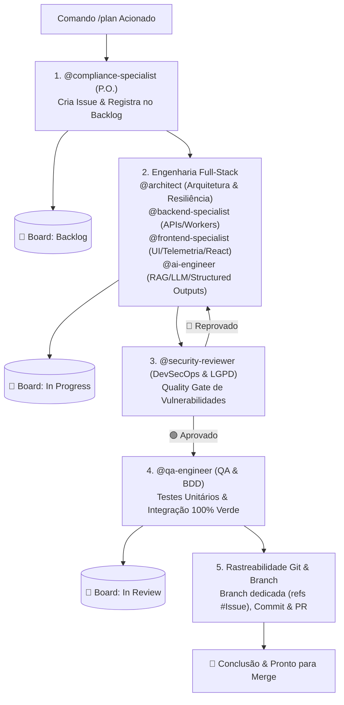

# 🚀 Pipeline de Execução Obrigatória: `/plan` & Ciclo de Vida do Board

> **REGRA IMPERATIVA:** Toda vez que o comando `/plan` for acionado pelo usuário, o assistente **DEVE OBRIGATORIAMENTE** seguir este pipeline sequencial de agentes e transições no GitHub Projects. **NENHUM estágio pode ser ignorado ou executado fora de ordem.**

---

## 📋 Estágio 1: Product Owner Regulatória & Backlog (@compliance-specialist)
- **Agente Responsável:** `@compliance-specialist` (Skill: `compliance-specialist`)
- **Ações:**
  1. Analisar os requisitos do usuário e decompor o escopo em **Épicos** e **Histórias de Usuário** (*Como... quero... para...*).
  2. Mapear aderência regulatória: Resoluções do CFM (2.336/2023, 2.314/2022), ANS, ANVISA e LGPD Art. 11.
  3. Definir critérios de aceitação funcionais e deontológicos.
  4. **GitHub Issue:** Criar formalmente a Issue/Draft no GitHub (`Conform-AI-health/conform-ai-health`).
- **Ação no GitHub Projects Board:**
  - Adicionar o item ao board [Conform.AI - Backlog & Roadmap](https://github.com/orgs/Conform-AI-health/projects/3/views/1) e posicionar na coluna **`Backlog`**.

---

## ⚙️ Estágio 2: Arquitetura & Codificação Full-Stack
- **Agentes Participantes:**
  - `@architect` (`.agents/agents/architect.md` | Skill: `architecture-review`): Desenho de arquitetura, contratos de saída estruturados (`StructuredAuditContract`), padrões de resiliência (**Circuit Breaker** e **Bulkhead**), e modelos de dados Prisma/MongoDB.
  - `@backend-specialist` (`.agents/agents/backend-specialist.md` | Skill: `backend-engineer`): Endpoints REST Express, paginação (`skip`/`take`), validação Zod, autenticação com refresh token de 1h, e workers BullMQ.
  - `@frontend-specialist` (`.agents/agents/frontend-specialist.md` | Skill: `frontend-engineer`): Telas React 18, Vite, componentes Tailwind CSS, dashboards de telemetria analítica (latência P95, custos USD/BRL, taxas de falhas), estados reativos e RBAC na UI.
  - `@ai-engineer` (`.agents/agents/ai-engineer.md` | Skills: `rag-engineering` e `prompt-engineering`): Integração com LLMs (Gemini, Ollama), **Guardrails Anti-Alucinação** (normativo e fático), contratos estruturados, chunking semântico e filtragem de resoluções revogadas.
- **Ações:**
  1. O `@architect` desenha os contratos e especificações técnicas a partir das issues criadas.
  2. O `@backend-specialist` e `@ai-engineer` implementam os serviços, endpoints, guardrails e regras de dados.
  3. O `@frontend-specialist` implementa a interface, tabelas de observabilidade e fluxos de navegação.
- **Ação no GitHub Projects Board:**
  - Ao iniciar a especificação e codificação, mover a tarefa no board para **`In Progress`** (Em Andamento).

---

## 🛡️ Estágio 3: Auditoria de Segurança & DevSecOps (@security-reviewer)
- **Agente Responsável:** `@security-reviewer` (`.agents/agents/security-reviewer.md` | Skill: `security-engineer`)
- **Ações:**
  1. Análise estática (SAST) e auditoria OWASP Top 10:
     - Blindagem de infraestrutura e contêineres Docker (eliminação de segredos em texto plano, isolamento de portas do Redis, restrição `no-new-privileges:true` e limites de CPU/RAM).
     - Sanitização de inputs para evitar NoSQL Injection e injeções de prompt.
     - Validação de limites máximos de paginação (`limit <= 100`) para mitigar Denial of Service (DoS) por sobrecarga de memória.
     - Validação estrita de RBAC e isolamento multi-tenant (`enforceTenantIsolation`).
  2. **Quality Gate:** Se houver apontamentos, a tarefa permanece em **`In Progress`** e retorna para ajustes no Estágio 2. Se aprovada, avança para QA.

---

## 🧪 Estágio 4: Engenharia de Testes, QA & Review (@qa-engineer)
- **Agente Responsável:** `@qa-engineer` (`.agents/agents/qa-engineer.md` | Skill: `testing`)
- **Ações:**
  1. Criação de cenários BDD/Gherkin baseados nos critérios de aceitação.
  2. Construção de testes automatizados:
     - **Backend:** Testes unitários e de integração de endpoints, guardrails anti-alucinação, resiliência (Circuit Breaker e Bulkhead) e serviços com mocks via Vitest.
     - **Frontend:** Testes de renderização de componentes, paginação e fluxos no React via Vitest + Testing Library.
  3. Executar e validar que a suíte roda com **100% de sucesso (`npm test`)** e builds de produção sem erros (`tsc` e `vite build`).
- **Ação no GitHub Projects Board:**
  - Após os testes serem gerados e aprovados, **mover obrigatoriamente a issue para a coluna `In review`**.

---

## 🌿 Estágio 5: Branch Git & Rastreabilidade (@architect + Time)
- **Agentes Participantes:** `@architect` e Time de Engenharia
- **Ações:**
  1. Criar branch dedicada no Git referenciando a issue: `git checkout -b feat/issue-<ID>-<slug>` (ou `fix/...`).
  2. Realizar commits claros com rastreabilidade: `git commit -m "... (refs #<ID>)"`.
  3. Enviar para o repositório remoto (`git push origin <branch>`).
  4. Sincronizar o item no GitHub Projects Board #3 com o commit e link do Pull Request.
