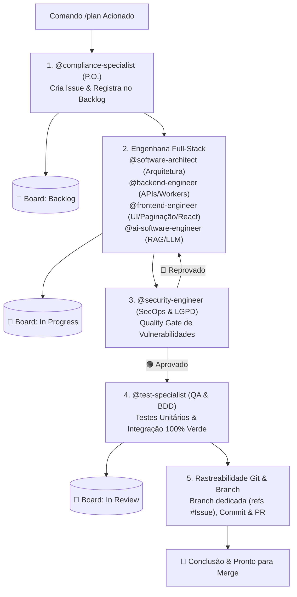

# 🚀 Pipeline de Execução Obrigatória: `/plan` & Ciclo de Vida do Board

> **REGRA IMPERATIVA:** Toda vez que o comando `/plan` for acionado pelo usuário, o assistente **DEVE OBRIGATORIAMENTE** seguir este pipeline sequencial de agentes e transições no GitHub Projects. **NENHUM estágio pode ser ignorado ou executado fora de ordem.**

---

## 📋 Estágio 1: Product Owner Regulatória & Backlog (@compliance-specialist)
- **Ações:**
  1. Analisar os requisitos do usuário e decompor o escopo em **Épicos** e **Histórias de Usuário** (*Como... quero... para...*).
  2. Mapear aderência regulatória: Resoluções do CFM (2.336/2023, 2.314/2022), ANS, ANVISA e LGPD Art. 11.
  3. Definir critérios de aceitação funcionais e deontológicos.
  4. **GitHub Issue:** Criar formalmente a Issue no GitHub (`Conform-AI-health/conform-ai-health`) com labels: `user-story`, `padrão-po`, `compliance`.
- **Ação no GitHub Projects Board:**
  - Adicionar o item ao board [Conform.AI - Backlog & Roadmap](https://github.com/orgs/Conform-AI-health/projects/3/views/1) e posicionar na coluna **`Backlog`**.

---

## ⚙️ Estágio 2: Arquitetura & Codificação Full-Stack
- **Agentes Participantes:**
  - `@software-architect`: Desenho de arquitetura, fluxos Mermaid, contratos de API e modelos de dados.
  - `@backend-engineer`: Endpoints REST Express, paginação (`skip`/`take`), validação Zod, Prisma ORM e filas BullMQ.
  - `@frontend-engineer`: Telas React 18, Vite, componentes Tailwind CSS, controles de paginação de tabelas, botões de teste de modelo de IA, estados reativos e RBAC na UI.
  - `@ai-software-engineer`: Integração com LLMs (Gemini, Ollama), prompts estruturados, fallback determinístico e métricas de inferência.
- **Ações:**
  1. O Arquiteto desenha os contratos e especificações técnicas a partir das issues criadas.
  2. O `@backend-engineer` implementa os serviços, endpoints e regras de dados.
  3. O `@frontend-engineer` implementa a interface, paginação de tabelas e botões de ação na UI.
- **Ação no GitHub Projects Board:**
  - Ao iniciar a especificação e codificação, mover a tarefa no board para **`In Progress`** (Em Andamento).

---

## 🛡️ Estágio 3: Auditoria de Segurança & DevSecOps (@security-engineer)
- **Ações:**
  1. Análise estática (SAST) e auditoria OWASP Top 10:
     - Sanitização de inputs para evitar NoSQL Injection.
     - Validação de limites máximos de paginação (`limit <= 100`) para mitigar Denial of Service (DoS) por sobrecarga de memória.
     - Validação e proteção de endpoints de teste de IA contra prompt injection ou exaustão de tokens.
     - Validação estrita de RBAC e isolamento multi-tenant (`enforceTenantIsolation`).
  2. **Quality Gate:** Se houver apontamentos, a tarefa permanece em **`In Progress`** e retorna para ajustes no Estágio 2. Se aprovada, avança para QA.

---

## 🧪 Estágio 4: Engenharia de Testes, QA & Review (@test-specialist)
- **Ações:**
  1. Criação de cenários BDD/Gherkin baseados nos critérios de aceitação.
  2. Construção de testes automatizados:
     - **Backend:** Testes unitários e de integração de endpoints, paginação e serviços com mocks via Vitest.
     - **Frontend:** Testes de renderização de componentes, paginação e botões de teste no React via Vitest + Testing Library.
  3. Executar e validar que a suíte roda com **100% de sucesso (`npm test`)**.
- **Ação no GitHub Projects Board:**
  - Após os testes serem gerados e aprovados, **mover obrigatoriamente a issue para a coluna `In review`**.

---

## 🌿 Estágio 5: Branch Git & Rastreabilidade (@software-architect + Time)
- **Ações:**
  1. Criar branch dedicada no Git referenciando a issue: `git checkout -b feat/issue-<ID>-<slug>` (ou `fix/...`).
  2. Realizar commits claros com rastreabilidade: `git commit -m "... (refs #<ID>)"`.
  3. Enviar para o repositório remoto (`git push origin <branch>`).
  4. Registrar o link da branch / Pull Request na Issue do GitHub.
