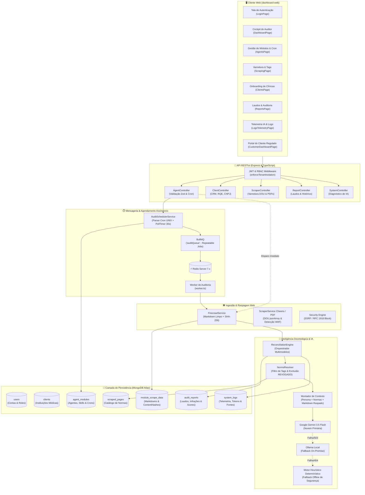
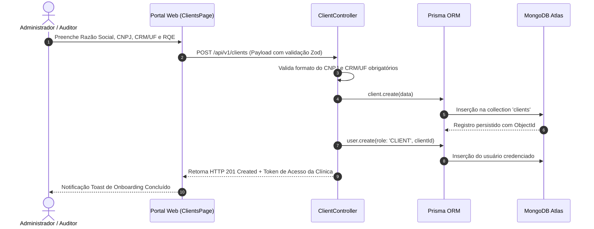
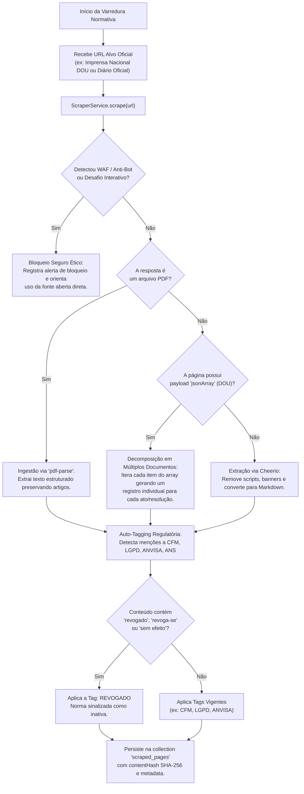
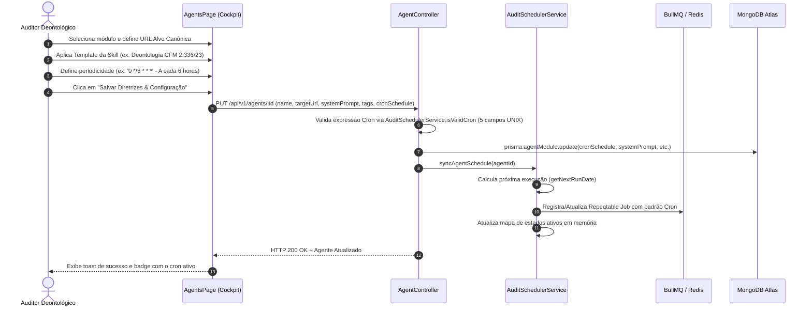
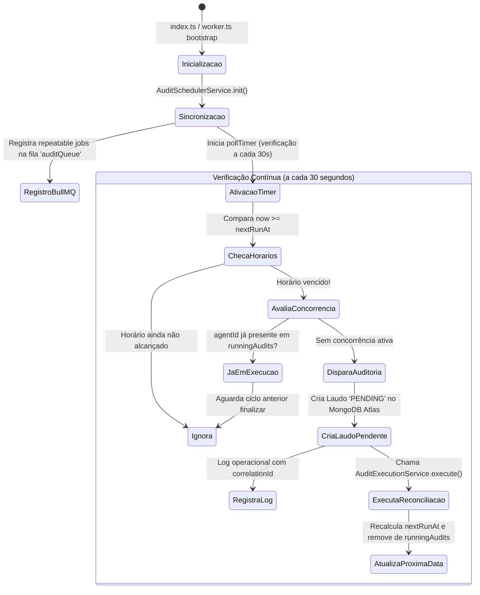
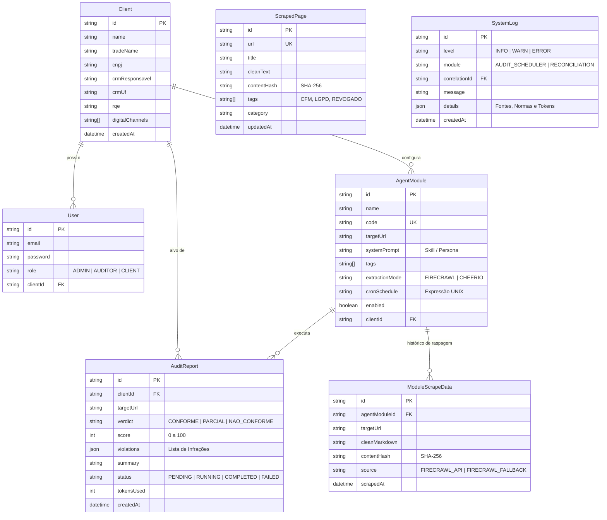
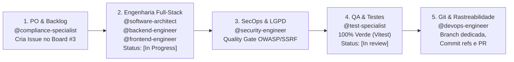

# 📘 Conform.AI Health — Fluxo Detalhado do Projeto e Arquitetura do Sistema

> **Documento Oficial de Engenharia & Arquitetura de Software**  
> **Versão:** 1.2.0  
> **Última Atualização:** 2026-11-08  
> **Marcos Regulatórios:** Resolução CFM nº 2.336/2023, Resolução CFM nº 2.314/2022, Lei Geral de Proteção de Dados (LGPD - Lei 13.709/18, Art. 11), ANVISA RDC nº 727/2022 e ANS RN 509/395.

---

## 📑 Sumário Executivo

O **Conform.AI Health** é uma plataforma distribuída de alta disponibilidade voltada para a **governança ética, deontológica e regulatória automatizada de instituições e profissionais de saúde** em seus canais digitais (websites, portais de agendamento e redes públicas).

O ecossistema realiza vigilância contínua 24/7 combinando **raspagem limpa de dados via Firecrawl**, **resolução dinâmica de normas jurídicas no MongoDB Atlas**, **orquestração de Inteligência Artificial generativa com fallback resiliente de três camadas** e **agendamento temporal autônomo (Cron/BullMQ)**.

---

## 🏛️ 1. Arquitetura Geral do Ecossistema

O sistema adota uma arquitetura em camadas orientada a microsserviços e workers concorrentes, desacoplando a experiência visual no navegador do processamento pesado de extração e reconciliação com IA:



---

## 🔄 2. Detalhamento dos Fluxos Operacionais

### 2.1. Fluxo de Onboarding de Clínicas Médicas e Isolamento Multi-Tenant

Garante a segregação estrita de dados clínicos conforme exigido pela LGPD e pelos códigos de ética médica.



---

### 2.2. Fluxo de Varredura Normativa, Ingestão no DOU e Etiquetagem de Revogação

O sistema alimenta seu repositório de dispositivos legais através de scrapers especializados:



---

### 2.3. Fluxo de Configuração do Módulo de Agente & Agendamento Contínuo (Cron)

O módulo de agente reúne a **Skill deontológica**, as **Tags de vínculo** e o **Padrão temporal** de auditoria:



---

### 2.4. Fluxo do Motor de Agendamento em Background (Loop 24/7)

O motor atua de forma ininterrupta, garantindo a execução programada tanto em clusters com Redis quanto em instâncias isoladas com timer de contingência:



---

### 2.5. Fluxo de Reconciliação Deontológica com IA & Resolução de Normas

O núcleo analítico onde ocorre o confronto entre o conteúdo digital capturado e o acervo normativo:

```mermaid
flowchart TD
    Trigger["Disparo da Auditoria\n(Manual Imediato ou Cron Programado)"] --> ScrapeTarget["FirecrawlService.scrape(targetUrl)\nExtração limpa para Markdown e\ncálculo do contentHash SHA-256"]
    
    ScrapeTarget --> SaveScrape["Salva snapshot em 'module_scrape_data'\ncom URL, markdown e hash único."]
    SaveScrape --> ResolveNorms["NormsResolver.resolveByTags(agent.tags)"]
    
    subgraph Norms_Filter ["Filtro Rigoroso de Deontologia"]
        ResolveNorms --> QueryDB["Consulta collection 'scraped_pages'\nfiltrando pelas tags do módulo (ex: CFM, LGPD)"]
        QueryDB --> CheckTagRevogada{"Documento possui a\ntag 'REVOGADO'?"}
        CheckTagRevogada -- Sim --> ExcludeRevogada["🚫 EXCLUI ESTRITAMENTE:\nNorma revogada é descartada e não entra no prompt."]
        CheckTagRevogada -- Não --> IncludeVigente["⚖️ INCLUI NO CONTEXTO:\nNorma oficial ativa é selecionada."]
    end

    ExcludeRevogada --> AssemblePrompt
    IncludeVigente --> AssemblePrompt["Montagem do Prompt Deontológico:\n1. Persona & Skill Comportamental do Agente\n2. Normas Vigentes Selecionadas\n3. Markdown Oficial Raspado via Firecrawl\n4. Schema JSON Estrito de Veredito"]

    AssemblePrompt --> SendToGemini["Tentativa Primária:\nGoogle Gemini 3.5 Flash API"]
    SendToGemini --> CheckGemini{"Resposta Gemini\nVálida e Rápida?"}
    
    CheckGemini -- Sim --> ParseJSON["Parsing & Validação do JSON do Laudo"]
    CheckGemini -- Não / Erro 503 --> FallbackOllama["Fallback Camada 2:\nOllama Local (On-Premise)"]
    
    FallbackOllama --> CheckOllama{"Resposta Ollama\nRecebida com Sucesso?"}
    CheckOllama -- Sim --> ParseJSON
    CheckOllama -- Não / Erro 404 --> FallbackHeuristic["Fallback Camada 3:\nMotor Heurístico Baseado em Regras\n(Valida CRM, RQE, Antes/Depois, Preços e Consentimento)"]

    FallbackHeuristic --> ParseJSON
    
    ParseJSON --> ComputeScore["Cálculo de Indicadores:\n- Score Deontológico (0 a 100)\n- Veredito (CONFORME, PARCIALMENTE_CONFORME, NAO_CONFORME)\n- Lista de Violações com Dispositivo Legal e Recomendação"]
    
    ComputeScore --> PersistReport["Atualiza Laudo em 'audit_reports'\ncom Status 'COMPLETED' e veredito."]
    ComputeScore --> PersistTelemetry["Registra em 'system_logs':\nTokens consumidos, latência em ms,\nprovedor de IA utilizado e\nlista exata de normas/fontes consideradas."]
```



---

## 📊 3. Modelo de Dados Relacional & NoSQL (MongoDB Atlas / Prisma)



---

## 🛠️ 4. Matriz de Componentes e Responsabilidades no Código

| Componente | Caminho do Arquivo | Responsabilidade Técnica Principal |
| :--- | :--- | :--- |
| **AuditSchedulerService** | `dashboard/src/services/auditSchedulerService.ts` | Motor temporal autônomo. Validação de expressões Cron de 5 campos, cálculo de `nextRunAt`, registro de repeatable jobs no BullMQ e polling de segurança a cada 30 segundos. |
| **ReconciliationEngine** | `dashboard/src/services/reconciliationEngine.ts` | Orquestrador de IA de 3 camadas (Gemini -> Ollama -> Heurística). Processa vereditos deontológicos, score e violações normativas. |
| **NormsResolver** | `dashboard/src/services/normsResolver.ts` | Resolução dinâmica de dispositivos legais no MongoDB Atlas via tags, com **exclusão incondicional de normas com a tag `REVOGADO`**. |
| **FirecrawlService** | `dashboard/src/services/firecrawlService.ts` | Extração de páginas web para Markdown limpo via API do Firecrawl ou motor nativo, calculando hashes SHA-256 para auditoria rastreável. |
| **ScraperService** | `dashboard/src/services/scraperService.ts` | Varredura de páginas regulatórias complexas, Diário Oficial da União (DOU com decomposição `jsonArray`) e leitura de PDFs oficiais via `pdf-parse`. |
| **MainLayout** | `dashboard-web/src/components/MainLayout.tsx` | Layout corporativo responsivo em dark glass, incorporando o novo logotipo oficial 3D `CONFORM.AI`, menu lateral RBAC e monitor em tempo real dos marcos regulatórios. |
| **AgentsPage** | `dashboard-web/src/pages/AgentsPage.tsx` | Cockpit central de módulos. Permite configuração unificada da URL Alvo Oficial, Persona/Skill deontológica, seletor de tags e campo de Cron com presets recomendados. |
| **LoginPage** | `dashboard-web/src/pages/LoginPage.tsx` | Tela de autenticação com apresentação do emblema 3D da Conform.AI, aura azul/ciano e formulário estilizado com credenciais seguras. |
| **LogsTelemetryPage** | `dashboard-web/src/pages/LogsTelemetryPage.tsx` | Painel de observabilidade de IA, telemetria de tokens consumidos e diálogo modal para inspeção detalhada de todas as fontes/normas utilizadas na inferência. |

---

## 🛡️ 5. Ciclo de Vida e Pipeline de Engenharia (`plan-pipeline.md`)

Qualquer nova funcionalidade ou refatoração no projeto segue **obrigatoriamente o ciclo em 5 estágios sequenciais**:



1. **Estágio 1 (Product Owner):** Decomposição em Histórias de Usuário, critérios de aceitação e registro no GitHub Projects Board #3 (`Backlog`).
2. **Estágio 2 (Arquitetura & Engenharia):** Movimentação para `In Progress`, implementação no backend/frontend com TypeScript estrito.
3. **Estágio 3 (Segurança & SecOps):** Validação contra SSRF, sanitização de inputs, limites de taxa e segregação de tenants.
4. **Estágio 4 (Engenharia de Testes):** Criação e execução de testes unitários e de integração (100% aprovados), transição da issue para `In review`.
5. **Estágio 5 (Git & Rastreabilidade):** Branch dedicada com Conventional Commits referenciando o ID da tarefa (`refs #PVTI_...`) e envio para o repositório remoto.

---

## 🚀 6. Guia Rápido de Execução

### Execução Local dos Testes
```bash
# Executa todos os testes de frontend e backend
npx vitest run
```

### Compilação de Produção
```bash
# Compila o backend (TypeScript) e o frontend (Vite)
npm run build
```

### Inicialização com Docker Compose
```bash
# Sobe todo o ecossistema (MongoDB, Redis, API, Worker e Frontend Web)
docker compose up -d --build
```
