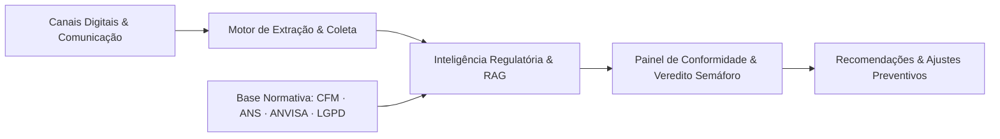

# 🏥 ConformIA — Inteligência e Governança Regulatória em Saúde

> Plataforma inteligente para auditoria contínua, governança ética e conformidade deontológica no ecossistema de saúde digital.

---

## 💡 A Proposta de Valor

A publicidade e a comunicação no setor de saúde no Brasil são regidas por normas deontológicas rigorosas estabelecidas pelos conselhos de classe e órgãos reguladores (**CFM nº 2.336/2023**, **ANS**, **ANVISA** e **LGPD em Saúde**). O descumprimento inadvertido dessas diretrizes pode acarretar processos ético-profissionais, multas e danos reputacionais severos.

O **ConformIA** atua como uma camada automatizada de proteção e monitoramento preventivo para **clínicas médicas, hospitais, operadoras de saúde e HealthTechs**, assegurando que seus canais digitais, páginas e campanhas estejam permanentemente aderentes à legislação vigente.

---

## 🎯 Principais Capacidades

- 🔍 **Varredura e Auditoria Contínua:** Coleta e monitoramento sistemático de websites, landing pages e canais digitais de saúde.
- ⚖️ **Auditoria Regulatória com IA:** Análise semântica profunda de textos, alegações e imagens confrontadas diretamente com as resoluções vigentes (obrigatoriedade de CRM/RQE, proibição de sensacionalismo, regras de antes e depois educativo, e vedação à mercantilização).
- 🚥 **Veredito em Semáforo:** Classificação visual instantânea do nível de conformidade (Verde = Regular, Amarelo = Atenção/Revisão, Vermelho = Violação Deontológica).
- 📋 **Recomendações Corretivas:** Orientações práticas e fundamentadas na legislação para que o corpo médico e a equipe de marketing façam ajustes imediatos.
- 🛡️ **Painéis Segmentados:** Ambientes dedicados para auditorias institucionais e um portal exclusivo para o cliente acompanhar seu histórico de conformidade com total privacidade.

---

## 🔄 Como Funciona (Visão Conceitual)

1. **Coleta de Conteúdo:** O sistema analisa de forma automatizada o conteúdo público veiculado nos canais oficiais da instituição.
2. **Avaliação Normativa:** O motor de inteligência artificial cruza cada dispositivo publicado com a base legal de resoluções de saúde.
3. **Entrega de Relatórios:** Geração de diagnósticos de risco com apontamentos de severidade (*Leve*, *Média*, *Grave* ou *Crítica*) e ações sugeridas.

---

## 👥 A Quem Se Destina

- **Clínicas e Consultórios Médicos:** Prevenção ativa contra notificações e processos nos Conselhos Regionais de Medicina (CRMs).
- **Hospitais e Operadoras de Saúde:** Garantia de conformidade nas regras de credenciamento e transparência exigidas pela ANS.
- **HealthTechs e Plataformas de Agendamento:** Governança no tratamento de dados sensíveis de pacientes (LGPD Saúde) e checagem de especialidades anunciadas.
- **Agências de Marketing em Saúde:** Homologação prévia de campanhas antes da veiculação pública.

---

## 🔒 Segurança e Privacidade de Dados

O ConformIA foi concebido seguindo princípios rigorosos de **Privacy by Design** e **Security by Default**:

- Isolamento estrito de dados entre organizações (*Multi-Tenancy Isolation*).
- Tratamento restrito de dados públicos e proteção de informações em conformidade com a LGPD (Lei nº 13.709/2018).
- Todas as credenciais de infraestrutura e parâmetros de execução são estritamente isolados em ambiente corporativo seguro.

---

## 🛡️ Política de Segurança e Divulgação Responsável

Caso você identifique qualquer vulnerabilidade de segurança ou comportamento anômalo, solicitamos que reporte de forma privada e responsável diretamente para o time de segurança, sem publicação de exploits em canais abertos:

- **E-mail de Segurança:** `security@conformai.health`

---

## 📄 Propriedade e Direitos

Projeto proprietário do ecossistema **ConformIA**. Todos os direitos reservados.
