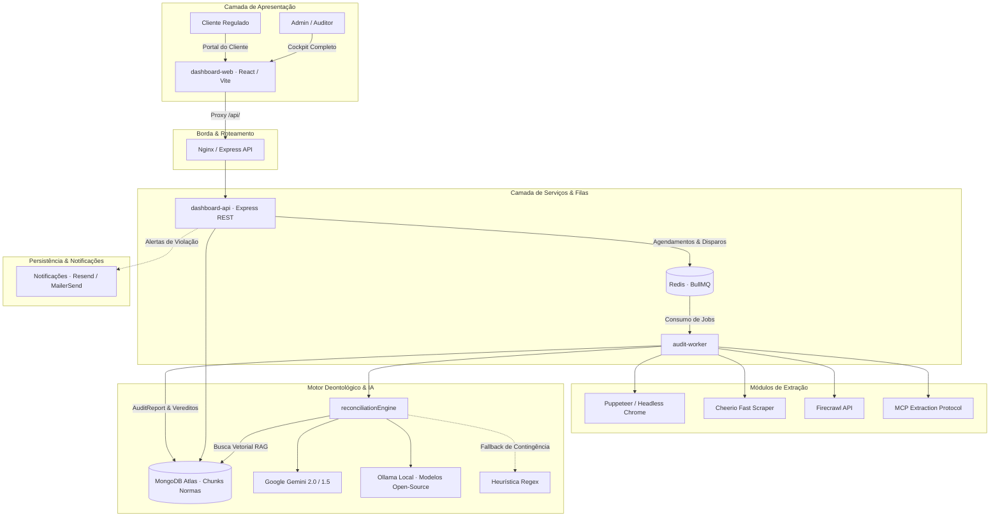

# 🏥 ConformIA — Plataforma de Inteligência e Compliance Regulatório em Saúde

Plataforma inteligente de auditoria e governança deontológica para **HealthTechs, hospitais, clínicas e profissionais de saúde**. A solução monitora a conformidade de sites, páginas e materiais de comunicação em relação às normas dos conselhos e agências reguladoras brasileiras (**CFM nº 2.336/2023**, **ANS**, **ANVISA** e **LGPD Saúde**), combinando web scraping avançado, inteligência artificial multimodal (RAG), processamento assíncrono em filas e visualização intuitiva em semáforo.

---

## 🏗️ Arquitetura do Sistema

A solução é baseada em uma arquitetura de microsserviços desacoplada e conteinerizada:

| Componente | Diretório | Porta / Serviço | Tecnologias Principais | Papel no Ecossistema |
| :--- | :--- | :--- | :--- | :--- |
| **`dashboard-web`** | [`dashboard-web/`](dashboard-web/) | `:3000` (Docker) / `:5173` (Dev) | React 18, Vite 6, Tailwind CSS 3, Lucide, React Router v7 | Frontend SPA para auditores/administradores e **Portal do Cliente exclusivo**. |
| **`dashboard-api`** | [`dashboard/`](dashboard/) | `:3333` (Docker) / `:3000` (Dev) | Node.js 20+, Express, TypeScript, Prisma 5, Zod | API RESTful (`/api/v1`), autenticação JWT, RBAC multi-tenant e orquestração. |
| **`audit-worker`** | [`dashboard/`](dashboard/) | Background Worker | BullMQ 6, ioredis, Puppeteer, Cheerio, Firecrawl | Worker assíncrono para extração de conteúdo e reconciliação deontológica. |
| **`redis`** | — | `:6379` | Redis 7 Alpine | Gerenciamento de filas BullMQ, agendamentos cron, pub/sub e cache de telemetria. |
| **`MongoDB Atlas`** | Nuvem externa | `:27017` | MongoDB Replica Set (Prisma + Mongoose) | Persistência de usuários, clientes, agentes, relatórios de auditoria e chunks de RAG vetorial. |



---

## ⚡ Ciclo de Vida da Auditoria

1. **Agendamento & Gatilhos:**
   - No boot da aplicação, a API inicializa os agendadores BullMQ para agentes marcados como `ATIVO`.
   - Execuções sob demanda podem ser acionadas a qualquer momento via `POST /api/v1/agents/:id/run`.
2. **Extração de Conteúdo Web:**
   - O worker executa o extrator configurado para o cliente (`PUPPETEER`, `CHEERIO`, `FIRECRAWL` ou `MCP`), capturando texto, metadados, links e evidências visuais.
3. **Análise Deontológica Inteligente (RAG):**
   - O `reconciliationEngine` recupera os artigos normativos relevantes no MongoDB (ex: Resolução CFM nº 2.336/2023 sobre anúncios de especialidade e RQE).
   - O conteúdo extraído é submetido à IA generativa com saída estruturada estrita (**Zod JSON Schema**).
   - **Cascata de Resiliência:** Gemini 2.0 Flash ➔ Ollama Local ➔ Heurística por Regex/Regras.
4. **Classificação & Veredito Semáforo:**
   - Cada apontamento recebe uma severidade: `LEVE`, `MEDIA`, `GRAVE` ou `CRITICA`.
   - Um relatório imutável `AuditReport` é gerado, atualizando as métricas do cliente e notificando os responsáveis.

---

## 👥 Perfis de Acesso & Controle de Permissões (RBAC)

A plataforma implementa controle de acesso rigoroso com isolamento de inquilinos (*tenant isolation*):

| Perfil | Nível de Acesso | Escopo de Visão e Recursos |
| :--- | :--- | :--- |
| **`ADMIN`** | Acesso Total | Gestão completa de usuários, clientes, troca de provider de IA em runtime, redefinição de senhas, migrações e auditoria global. |
| **`AUDITOR`** | Gestão de Conformidade | Cadastro de clientes, edição de agentes e regras normativas, disparo de auditorias manuais e análise de relatórios. |
| **`CLIENT`** | **Portal do Cliente** | Visão restrita e isolada exclusivamente aos dados de sua própria clínica/empresa (`/customer-dashboard`). Consulta normas ativas, status de conformidade e orientações de adequação. |
| **`VIEWER`** | Somente Leitura | Consulta relatórios públicos e dashboards básicos sem permissão de disparo ou alteração de configurações. |

---

## 🚀 Como Executar

### Opção 1: Com Docker Compose (Recomendado para Produção/Homologação)

Certifique-se de ter o Docker e Docker Compose instalados.

```bash
# 1. Copie o arquivo de exemplo e configure suas variáveis
cp .env.example .env

# 2. Suba todos os containers (Redis, API, Worker e Web)
docker compose up -d --build

# 3. Acompanhe os logs da aplicação e dos workers
docker compose logs -f
```

- **Frontend Web:** [http://localhost:3000](http://localhost:3000)
- **API REST:** [http://localhost:3333/api/v1](http://localhost:3333/api/v1) (Healthcheck: `/api/v1/health`)
- Documentação detalhada de containers em [DOCKER.md](DOCKER.md).

---

### Opção 2: Desenvolvimento Local (Sem Docker)

#### Pré-requisitos
- Node.js 20+ e npm
- Instância do Redis em execução (`localhost:6379`)
- Instância do MongoDB Atlas com Replica Set ativo

```bash
# 1. Instalar dependências em todos os módulos
npm run install:all

# 2. Configurar variáveis de ambiente do backend e do frontend
cp .env.example dashboard/.env
cp dashboard-web/.env.example dashboard-web/.env

# 3. Gerar os clientes do Prisma
npm run prisma:generate

# 4. Iniciar Backend e Frontend em modo de desenvolvimento simultâneo
npm run dev
```

- **Frontend (Vite com Hot-Reload):** [http://localhost:5173](http://localhost:5173)
- **Backend API (Nodemon / ts-node):** [http://localhost:3000/api/v1](http://localhost:3000/api/v1)
- O Vite está pré-configurado com proxy reverso direcionando chamadas `/api` automaticamente para o backend local.

---

## 🔐 Configuração de Ambiente (`.env`)

As credenciais e parâmetros sensíveis devem ser configurados no arquivo `.env`. Veja o catálogo das principais variáveis:

| Variável | Obrigatória | Finalidade |
| :--- | :--- | :--- |
| `DATABASE_URL` | **Sim** | String de conexão MongoDB Atlas (Replica Set obrigatório para transações Prisma). |
| `JWT_SECRET` | **Sim** | Chave de assinatura de tokens JWT (mínimo de 32 caracteres criptográficos). |
| `ADMIN_EMAIL` / `ADMIN_PASSWORD` | **Sim** | Credenciais do usuário Administrador inicial, auto-provisionado no primeiro boot. |
| `CONFORMIA_PROVIDER` | Não | Provedor de IA padrão (`gemini` ou `ollama`). Padrão: `gemini`. |
| `GEMINI_API_KEY` | Recomendado | Chave da Google AI Studio para inferência com modelos `gemini-2.0-flash`. |
| `REDIS_URL` | Não | Endereço do Redis (padrão: `redis://localhost:6379`). |
| `FIRECRAWL_API_KEY` | Opcional | Chave para extração de sites com rendering dinâmico avançado. |
| `RESEND_API_KEY` | Opcional | Provedor de envio de notificações e e-mails de alerta. |

---

## 🤖 Squad de Agentes Especialistas (`.github/agents/`)

O repositório conta com uma equipe de **8 agentes especialistas virtuais** prontos para auxiliar no ciclo de desenvolvimento, arquitetura, testes e conformidade médica:

```text
.github/agents/
├── README.md                     # Guia mestre e matriz de colaboração do Squad
├── software-architect.agent.md    # 🏛️ Arquiteto de Software (Sistemas Distribuídos & Escalabilidade)
├── backend-engineer.agent.md      # ⚙️ Engenheiro Backend (Node.js, Express, Prisma, MongoDB, BullMQ)
├── frontend-engineer.agent.md     # 🎨 Engenheiro Frontend (React 18, Vite, Tailwind CSS, UX/UI)
├── ai-software-engineer.agent.md  # 🤖 Engenheiro de IA & Cloud (LLMs, RAG Vetorial, MCP, LLMOps)
├── compliance-specialist.agent.md # ⚖️ Especialista Regulatório (CFM 2.336/23, ANS, ANVISA, LGPD Saúde)
├── security-engineer.agent.md     # 🛡️ Especialista em Cibersegurança & AppSec (OWASP Top 10, SAST)
├── test-specialist.agent.md       # 🧪 Especialista em QA & Testes (Vitest, Jest, Supertest, Mocks)
└── devops-engineer.agent.md       # 🚀 Engenheiro de DevOps & SRE (Docker, CI/CD, AWS EC2, Nginx)
```

Consulte [`.github/agents/README.md`](.github/agents/README.md) para detalhes sobre como acionar cada especialista usando a sintaxe `@nome-do-agente`.\

---

## 🧪 Validação de Tipos e Build

Para garantir que o código está livre de erros antes de submeter alterações:

```bash
# Typecheck estrito (TypeScript)
npm run typecheck

# Build de produção do backend e frontend
npm run build
```

---

## 📄 Licença e Uso

Este software é de propriedade intelectual proprietária do ecossistema **ConformIA**. Todos os direitos reservados.
