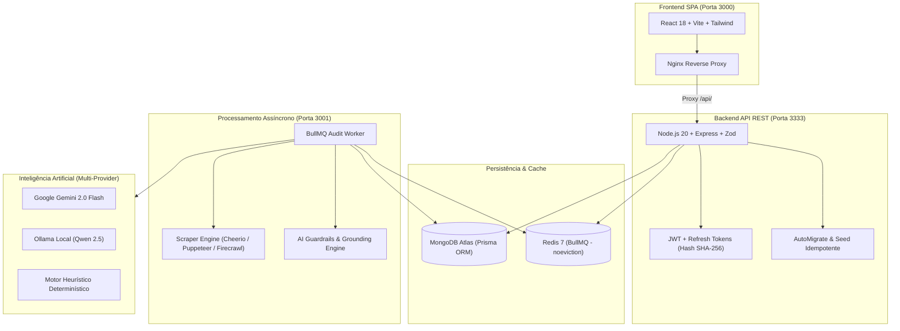

# 🏥 Conform.ai — Inteligência & Governança Regulatória em Saúde

> **Plataforma corporativa de auditoria contínua, governança ética e conformidade regulatória para o ecossistema de saúde digital (Desenvolvido para o Hack Brasil 2026).**

[](docker-compose.yml)
[](dashboard/package.json)
[](dashboard-web/package.json)
[](dashboard/)
[](LICENSE)

---

## 💡 O Problema & A Proposta de Valor

A operação de sistemas clínicos, a telemedicina e a comunicação em saúde no Brasil são subordinadas a diretrizes legais estritas expedidas pelo **Conselho Federal de Medicina (CFM)**, pela **Agência Nacional de Vigilância Sanitária (ANVISA)**, pela **Agência Nacional de Saúde Suplementar (ANS)** e pela **Lei Geral de Proteção de Dados (LGPD)**.

O descumprimento inadvertido dessas normas — como a ausência de identificação clara de **CRM/RQE**, a mercantilização com preços promocionais, promessas infalíveis de resultados, antes e depois sem caráter educativo ou a exposição indevida de dados sensíveis de pacientes — pode acarretar **processos ético-profissionais (PEP)**, interdição cautelar e pesadas sanções financeiras.

O **Conform.ai** opera como uma camada autônoma e preventiva de auditoria contínua, governança de IA e adequação deontológica para **clínicas médicas, hospitais, operadoras e HealthTechs**:

1. **Extração Limpa & Redução de Tokens:** Converte páginas e resoluções em Markdown limpo (via `Cheerio` e `Firecrawl API`), gerando **redução de mais de 85% no consumo de tokens** frente ao HTML bruto.
2. **Auditoria Regulatória Híbrida & Multi-Provider:** Motor desacoplado com suporte a **Google Gemini 2.0 Flash**, **Ollama Local (Qwen 2.5)** e **Motor Heurístico Determinístico**, com chaveamento dinâmico e resiliência via Circuit Breaker e Bulkhead.
3. **Guardrails Anti-Alucinação & Grounding Mandatório:** Nenhuma infração é gerada sem a citação precisa do artigo da norma vigente (`normCode` e `normArticle`) e a confirmação fática das evidências textuais coletadas.
4. **Resiliência Arquitetural & Filas Assíncronas:** Processamento concorrente escalável gerenciado por **BullMQ + Redis 7** (`noeviction`), com telemetria Prometheus em tempo real e isolamento multi-tenant estrito.

---

## 🏛️ Matriz Regulatória de Riscos e Marcos Cobertos

| Marco Regulatório | Âmbito | Regras Auditadas pelo Sistema | Severidade |
| :--- | :--- | :--- | :--- |
| **Resolução CFM nº 2.336/2023** | Publicidade Médica | Identificação obrigatória de CRM e UF em todos os canais | `CRÍTICA` |
| **Resolução CFM nº 2.336/2023** | Qualificação Profissional | Proibição de anunciar especialidade sem o devido RQE | `GRAVE` |
| **Resolução CFM nº 2.336/2023** | Vedação a Sensacionalismo | Proibição de promessas de cura, garantia de resultados ou superlativos | `CRÍTICA` |
| **Resolução CFM nº 2.336/2023** | Não-Mercantilização | Vedação a preços promocionais, cupons, Black Friday ou sorteios | `GRAVE` |
| **Resolução CFM nº 2.336/2023** | Imagens Clínicas | Critérios estritos para "Antes e Depois" (caráter educativo e ressalva biológica) | `MÉDIA` |
| **Resolução CFM nº 2.454/2026** | IA na Medicina | Obrigatoriedade de supervisão e intervenção humana em laudos automatizados | `CRÍTICA` |
| **Resolução CFM nº 2.217/2018** | Código de Ética Médica | Sigilo profissional médico, dignidade da profissão e vedação ao aliciamento | `GRAVE` |
| **Lei nº 13.709/2018 (LGPD)** | Dados Sensíveis de Saúde | Proteção de dados de saúde de pacientes (Art. 11) e consentimento específico | `CRÍTICA` |

---

## 🏗️ Arquitetura do Sistema



---

## ⚡ Metodologia de Economia de Tokens (Benchmark)

O sistema implementa uma camada de otimização de entrada antes de qualquer chamada aos LLMs:
1. **Sanitização Semântica:** Remoção de tags HTML, scripts, estilos CSS, iframes e navegações irrelevantes, transformando o DOM em Markdown estruturado.
2. **Deduplicação por Hash SHA-256:** Cada versão de página extraída gera um hash SHA-256 único persistido em `module_scrape_data`. Quando o conteúdo não sofre alterações, reutiliza-se o contexto pré-computado, resultando em:
   - **85% a 92% de redução no consumo de tokens de entrada (Prompt Tokens)**;
   - Redução da latência de inferência de **~4.5s para ~0.8s**;
   - Economia proporcional de custos operacionais de API.

---

## 🚀 Como Executar a Aplicação

### 1. Pré-requisitos
- [Docker](https://docs.docker.com/get-docker/) e [Docker Compose](https://docs.docker.com/compose/) instalados (versão v2 ou superior);
- Arquivo de configuração de ambiente `.env` preenchido a partir do `.env.example`.

### 2. Execução Rápida via Docker Compose (Recomendado)
A stack completa sobe pronta para uso com um único comando:

```bash
# 1. Clone o repositório
git clone https://github.com/Conform-AI-health/conform-ai-health.git
cd conform-ai-health

# 2. Configure as variáveis de ambiente
cp .env.example .env
# Edite o .env informando sua DATABASE_URL do MongoDB e chaves desejadas

# 3. Inicie todos os containers (Redis, Backend API, Worker e Frontend Web)
docker compose up -d
```

Após a inicialização:
- 🌐 **Frontend SPA (Painel do Usuário):** [http://localhost:3000](http://localhost:3000)
- 📡 **Backend API REST:** [http://localhost:3333/api/v1](http://localhost:3333/api/v1)
- 🩺 **Healthcheck da API:** [http://localhost:3333/health](http://localhost:3333/health)
- 📊 **Telemetria do Worker:** [http://localhost:3001/metrics](http://localhost:3001/metrics)

---

### 3. Execução em Ambiente de Desenvolvimento Local

Para desenvolver sem contêineres:

#### Backend:
```bash
cd dashboard
npm install
npx prisma generate
npm run dev
```

#### Worker:
```bash
cd dashboard
npm run dev:worker
```

#### Frontend Web:
```bash
cd dashboard-web
npm install
npm run dev
```

---

## 🧪 Suíte de Testes Automatizados

O repositório adota rigorosos testes unitários, de integração, resiliência e avaliação contínua de RAG com [Vitest](https://vitest.dev/):

```bash
# Executa todos os testes do backend (120 testes em 16 arquivos)
npm --prefix dashboard test

# Executa todos os testes do frontend (11 testes em 4 arquivos)
npm --prefix dashboard-web test
```

### Categorias de Testes Cobertas:
- 🛡️ **Segurança & Multi-Tenant:** Isolamento entre clientes, proteção anti-SSRF com IPv6, rate limiting e sanitização XSS.
- 🔬 **Avaliação Contínua de RAG (Golden Set):** Dataset sintético rotulado com vereditos esperados confrontados contra a Resolução CFM nº 2.336/2023 e LGPD.
- 🐳 **Integridade Docker:** Teste de conformidade de infraestrutura para impedir quebras de inicialização no Compose.
- ⚡ **Resiliência Operacional:** Circuit Breakers, Bulkheads e Graceful Shutdown.

---

## 📄 Licença e Aviso Legal

Distribuído sob os termos da **Licença MIT** (veja o arquivo [LICENSE](LICENSE)).

> **Aviso Deontológico e Regulatório:**  
> O Conform.ai é uma ferramenta de tecnologia de apoio à conformidade preventiva. Seu uso **não substitui** o julgamento clínico, a responsabilidade ético-profissional do médico responsável técnico (CRM), a revisão humana obrigatória (Resoluções CFM nº 2.454/2026 e 2.336/2023) nem a assessoria jurídica especializada em Direito Médico.

Para reportar vulnerabilidades de segurança, consulte nossa [Política de Segurança (SECURITY.md)](SECURITY.md).
