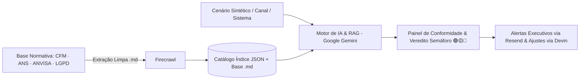

# 🏥 Conform.ai — Inteligência e Governança Regulatória em Saúde

> **Plataforma inteligente para auditoria contínua, governança ética e conformidade regulatória e deontológica no ecossistema de saúde digital (Desenvolvido no Hack Brasil 2026).**

---

## 💡 O Problema & A Proposta de Valor

A operação de sistemas clínicos e a comunicação no setor de saúde no Brasil são regidas por normas federais e deontológicas rigorosas estabelecidas pelos conselhos de classe e agências reguladoras (**CFM**, **ANS**, **ANVISA** e **LGPD em Saúde**). O descumprimento inadvertido dessas diretrizes — seja no fluxo de um software médico (Telemedicina, Prescrição Digital, IA Clínica) ou nos canais digitais — pode acarretar processos ético-profissionais, interdição de produtos, multas e danos reputacionais severos.

O **Conform.ai** atua como uma camada automatizada de proteção, monitoramento preventivo e adequação técnica para **HealthTechs, clínicas médicas, hospitais e operadoras de saúde**:
1. **Estrutura normas federais em Markdown limpo (`Firecrawl`)**, reduzindo em mais de **90% o consumo de tokens** em relação a documentos brutos;
2. **Audita fluxos e canais digitais em 2 estágios (`Google Gemini`)**, cruzando o cenário analisado apenas com as normas vigentes aplicáveis;
3. **Classifica o nível de conformidade em Semáforo (🟢/🟡/🔴)** com rastreabilidade ao artigo exato da norma;
4. **Dispara alertas executivos (`Resend`)** e **automatiza recomendações e correções técnicas via Pull Request (`Devin`)**.

---

## 🎯 Principais Capacidades & Escopo Regulatório

- 🔍 **Varredura e Auditoria Contínua:** Análise automatizada de fluxos de produtos digitais de saúde (SaMD, Telemedicina, Prescrição, IA) e de páginas/canais digitais (**CFM nº 2.454/2026**, **CFM nº 2.314/2022**, **CFM nº 2.299/2021**, **CFM nº**, **ANVISA RDC nº 657/2022**, **ANS** e **LGPD Art. 11**).
- ⚖️ **Auditoria Regulatória com IA em 2 Estágios:** Roteamento inteligente via catálogo índice de normas vigentes seguido de análise semântica profunda confrontada diretamente com os artigos aplicáveis.
- 🚥 **Veredito em Semáforo & Economia de Tokens:** Classificação visual instantânea do nível de conformidade (**Verde** = Regular, **Amarelo** = Atenção/Revisão, **Vermelho** = Violação Crítica) acompanhada do medidor de eficiência de contexto (*Token Efficiency Meter*).
- 📋 **Recomendações Corretivas & Automação:** Orientações práticas fundamentadas na legislação, envio de relatórios executivos por e-mail e geração assistida de ajustes técnicos no código-fonte.

---

## 🔄 Como Funciona (Visão Conceitual)



1. **Coleta e Estruturação:** O sistema organiza as normas regulatórias em Markdown limpo e recebe os parâmetros do sistema ou canal digital avaliado.
2. **Avaliação Normativa:** O motor de inteligência artificial cruza cada item analisado com a base legal vigente de resoluções de saúde.
3. **Entrega de Relatórios e Ação:** Geração de diagnósticos de risco com apontamentos de severidade (*Leve*, *Média*, *Grave* ou *Crítica*), alertas e ações corretivas sugeridas.

---

## 🧪 Exemplos de Uso (Cenários 100% Sintéticos — Regra 6.9 Hack Brasil)

> *Em cumprimento estrito à LGPD e ao Item 6.9 do Regulamento do Hack Brasil 2026, o projeto utiliza exclusivamente **dados e casos sintéticos**, sem qualquer exposição de dados pessoais reais de pacientes.*

- **Exemplo 1 — Auditoria de Fluxo de Prescrição Digital e Telemedicina:** Simulação de uma plataforma de teleconsulta avaliando a exigência de assinatura digital ICP-Brasil (**CFM nº 2.299/2021**), Termo de Consentimento Livre e Esclarecido (**CFM nº 2.314/2022**) e supervisão humana em módulos de IA médica (**CFM nº 2.454/2026**).
- **Exemplo 2 — Auditoria de Comunicação e Canais Digitais em Saúde:** Verificação automatizada de páginas institucionais confrontando a obrigatoriedade de exibição de CRM/RQE, vedação ao sensacionalismo/promessa de resultado (**CFM nº**) e transparência no tratamento de dados sensíveis (**LGPD Art. 11**).

---

## 🚀 Como Executar o Projeto

> *Status atual: Repositório inicializado para o Hack Brasil 2026 (Arquitetura em desenvolvimento ativo).*

### 1. Pré-requisitos
- **Node.js** `>= 20.x` e **npm** `>= 10.x`
- Configuração das variáveis de ambiente no arquivo `.env` (conforme `.env.example` a ser disponibilizado nos módulos da aplicação).

### 2. Passos para Execução Local
```bash
# 1. Clone este repositório público
git clone https://github.com/Conform-AI-health/conform-ai-health.git
cd conform-ai-health

# 2. Instale as dependências (conforme os módulos de backend/frontend forem integrados na branch main)
npm install

# 3. Inicie o ambiente de desenvolvimento
npm run dev
```

---

## 👥 Equipe & A Quem Se Destina

### Público-Alvo
- **HealthTechs e Plataformas de Saúde Digital:** Governança no ciclo de desenvolvimento de software médico (SaMD), telemedicina, IA clínica e LGPD.
- **Clínicas, Consultórios, Hospitais e Operadoras:** Prevenção ativa contra notificações em Conselhos (CFM) e garantia de conformidade nas regras da ANS e ANVISA.

### Time Conform.ai — Hack Brasil 2026
- **Augusto Rezende** — *PMO, Regulatory Data Lead & Pitch*
- **Mirella Batista Cruz** — *Product Owner (PO) & Clinical Product Lead*
- **Frederico Da Silva** — *CTO & Tech Lead*
- **Matheus Furtado** — *Clinical AI Governance, Compliance & CBA/ROI Lead*

---

## 🔒 Segurança, Dados e Direitos (Hack Brasil 2026)

- **Uso de Dados (Regra 6.9):** O projeto opera exclusivamente com normas regulatórias públicas e **cenários 100% sintéticos**, sem coleta ou exposição de dados pessoais reais de terceiros. Questões técnicas ou de segurança podem ser reportadas diretamente na aba **[Issues](https://github.com/Conform-AI-health/conform-ai-health/issues)** deste repositório.
- **Direitos e Licenciamento (Itens 6.1, 6.5 e 6.7):** Nos termos do Regulamento Oficial do Hack Brasil 2026, a propriedade intelectual do projeto pertence integralmente aos integrantes da equipe **Conform.ai**. Este repositório permanece público durante o período exigido pelo evento exclusivamente para fins de verificação, testes e avaliação pela Comissão Organizadora e pelo Júri.
  - *Modelo de licenciamento definitivo pós-evento: `[EM DEFINIÇÃO PELO TIME]`.*
